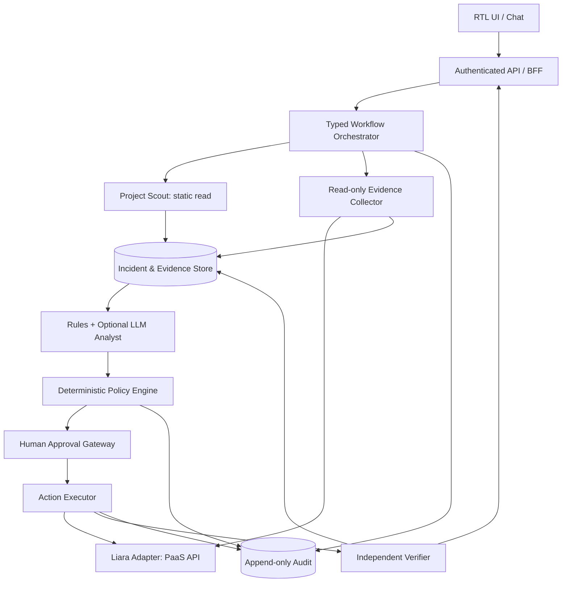
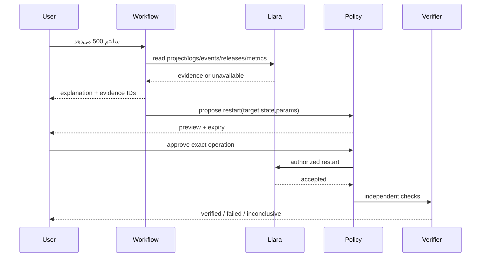

# 02 · معماری فنی و مرزهای اعتماد
**وضعیت:** طراحی هدف، نه کد نهایی.
## ۱. اصل معماری
یک Orchestrator با workflow مشخص و اجزای تخصصی، به‌جای شبکه‌ای از Agentهای با دسترسی نامحدود. **LLM پیشنهاد می‌دهد؛ Policy Engine اجازه می‌دهد؛ Adapter اجرا می‌کند؛ Verifier صحت را می‌سنجد.**

## ۲. اجزای مسئول
| جزء | مسئولیت | اجازه نوشتن روی لیارا |
|---|---|---|
| UI/BFF | session، پیام‌های ساده، جریان اقدامات و تأیید | خیر |
| Workflow | state, checkpoint, retries, deadlines | خیر |
| Scout | خواندن فایل manifest در sandbox، تشخیص stack/port/env names | خیر |
| Collector | خواندن projects/logs/events/releases/metrics/domain | خیر |
| Normalizer | schema validation، واحدها، UTC، dedupe، redaction | خیر |
| Rules/LLM | ساخت hypothesis و پیشنهاد تست read-only، نه API-call دلخواه | خیر |
| Policy+Approvals | تصمیم قطعی، محدودسازی actor/action/resource | خیر |
| Executor | فقط عملیات allowlisted با token سمت سرور | بله، با حکم Policy |
| Verifier | state و probe/metrics مستقل بعد از تغییر | خیر |
| Audit | ثبت forensic بدون secrets و نمایش تاریخچه | خیر |
## ۳. مدل استقرار پیشنهادی
**MVP:** Backend Python/FastAPI، تایپ Pydantic، SQLAlchemy+PostgreSQL یا SQLite فقط برای dev؛ Frontend مستقل Next.js/React یا سرور-رندر سبک بر حسب ظرفیت تیم. برای async jobs، Celery/RQ/Redis فقط در صورت نیاز؛ در P0 یک worker با جدول job و قفل DB کافی است. SDK لیارا یک facade HTTP با allowlist operation است؛ deploy می‌تواند از CLI رسمی از طریق subprocess با argv ثابت و workspace ایزوله استفاده کند، نه shell آزاد.
**Production-shaped:** TLS reverse proxy، secrets manager/env inject، Postgres transactional approvals، worker محدود، trace/metrics/logging، شبکه outbound allowlist، artifact store با حداقل retention.
## ۴. مدل دامنه و رکوردها
- `Workspace(id, owner_id, liara_account_ref, credential_ref, created_at)`
- `Service(id, workspace_id, project_name, allowed_probe_url, environment, last_seen_at)`
- `Operation(id, workflow_id, action, target_id, params_digest, state_digest, policy_version, status, created_at)`
- `Approval(id, operation_id, actor_id, digest, expires_at, consumed_at, decision)`
- `Incident(id, service_id, window_start/end, status, release_before/after, observed_at)`
- `Evidence(id, incident_id, source, observed_at, collected_at, payload_digest, excerpt_redacted, completeness, origin_ref)`
- `Hypothesis(id, incident_id, cause_code, confidence_band, supporting_evidence_ids, contradicting_ids, falsification_test)`
- `Verification(id, operation_id, check_id, status, observed_at, result_excerpt)`
- `AuditEntry(id, actor, action, target, request_id, policy_version, metadata_redacted, timestamp)`
هر رکورد دارای tenant/workspace scope؛ روی کلیدهای خارجی و فیلتر workspace آزمون isolation ضروری است.
## ۵. جریان داده و مرزهای اعتماد
1. Repository، لاگ و متن LLM **داده نامطمئن** هستند؛ هیچ‌کدام نقش دستور سیستمی یا Policy ندارند.
2. Client فقط eventهای sanitize‌شده می‌بیند؛ credential و env value هرگز در JSON مرورگر قرار نمی‌گیرند.
3. LLM ممکن است فقط evidence digest/excerpt پاک‌سازی‌شده دریافت کند. پاسخ آن با schema parse می‌شود، نه اجرا.
4. Executor تنها toolهای شناخته‌شده را با شناسه سرویس allowlisted فراخوانی می‌کند.
5. Job state و approval مصرف‌شده، در DB با قفل تراکنشی کنترل شوند؛ اجرا در retry تکراری نباشد.
## ۶. قرارداد خروجی Analyst
```json
{
  "incident_id": "inc_123",
  "assessment": "inconclusive",
  "hypotheses": [
    {"cause_code":"missing_env_key","confidence_band":"medium",
     "supporting_evidence_ids":["ev_1"],"contradicting_evidence_ids":[],
     "next_readonly_check":"compare_env_key_names"}
  ],
  "recommendation":{"action_type":"request_user_review","rationale_evidence_ids":["ev_1"]}
}
```
`confidence_band` کیفی است مگر کالیبراسیون و false-positive باید در تست بررسی شود. خروجی مدل هیچ `authorized=true` معتبری ندارد.
## ۷. مراحل اجرای deployment
- Scout فقط manifest و config را بررسی کند؛ code execution ممنوع.
- User runtime/platform/region/plan و هزینه واقعی را تأیید کند؛ عدم قطعیت را نشان بده.
- Deploy job در محیط sandbox با سورس کنترل‌شده و CLI نسخه pin‌شده اجرا شود؛ خروجی streaming پاک‌سازی گردد.
- پس از submit، status release پیگیری شود و پروب HTTP مجاز مستقل اجرا شود.
- تنظیم دامنه (به‌خصوص تغییر پنل رجیسترار/ایرنیک) handoff صریح؛ DNS و صدور SSL eventual consistency دارند.
## ۸. Diagram جریان مرجع

## ۹. Failure isolation
Timeout Liara read → degrade to insufficient_data؛ outage LLM → rule-based summary؛ Policy store unavailable → no mutations؛ approval missing/expired → reject؛ health probe unavailable → inconclusive؛ deploy submit timeout → poll release before considering retry.
## ۱۰. مقیاس‌پذیری تدریجی
نسخه پایه monolith modular است؛ شکستن آن به microservice پیش از فهم حجم کار و failure modes، هزینه اضافی ایجاد می‌کند. معیار استخراج سرویس: مالکیت داده/امنیت مستقل یا گلوگاه اندازه‌گیری‌شده.