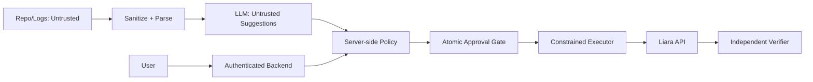

# 06 · Threat Model، امنیت عملیاتی و مجوز انسانی
## ۱. چارچوب تهدید
سیستم به زیرساخت و اسرار حساب دسترسی پیدا می‌کند؛ بنابراین فایل log، متن repo و خروجی مدل **untrusted input** هستند. راهبرد به توصیه‌های OWASP Top 10 برای Agentic Applications 2026، least privilege، اصل fail-closed و کنترل مسیر نوشتن مستقل از مدل تکیه دارد.
**دارایی‌ها:** توکن لیارا، تنظیمات محرمانه، مالکیت workspace، سلامت سرویس، یکپارچگی audit، هزینه و داده‌های ترافیک کاربران.
**مهاجمان/ریسک‌ها:** مهاجم نویسنده log یا README، کاربر یک workspace دیگر، سوءاستفاده از URL probe، تصادف worker، prompt injection، Approval replay، API timeout، insider با اختیارات زیاد.
## ۲. مرزهای اعتماد

بخش اجرای تغییر **هیچ دستور دلخواه، کد تولیدی مدل، command line پارامتر آزاد یا URL عمومی** قبول نمی‌کند.
## ۳. Risk classification
| کلاس | مثال | قاعده |
|---|---|---|
| R0 read | projects list, logs, metrics | authz + rate limit؛ بدون user-approval عملیاتی |
| R1 bounded diagnostic | DNS query، HTTP probe allowlisted | authz، SSRF guard، resource limits |
| R2 service-impacting | restart، deploy، env update، resize | preview + explicit approval + state check |
| R3 destructive/high-cost | delete app، delete disk، arbitrary shell، DB migration | در MVP disabled؛ نیازمند طراحی جداگانه و second confirmation |
Risk score بر مبنای blast radius/irreversibility/cost/production flag تعیین شود. Policy در code/test versioned است، نه prompt.
## ۴. Approval protocol (قابل پیاده‌سازی)
1. Backend با authority واقعی یک `ProposedOperation` شامل actor_id, workspace_id, target_id, action_enum, normalized parameters, state_digest, policy_version, expiry ایجاد می‌کند.
2. UI دقیقاً target، تغییر، پیامد، ریسک، نیاز به downtime، قابلیت بازگشت و plan verify را نمایش می‌دهد.
3. کاربر احراز هویت‌شده approve یا reject را صادر می‌کند. CSRF، session bind و role check لازم‌اند.
4. Transaction در DB approval را یک‌بار consume و operation را `EXECUTING` می‌کند. worker پیش از عمل scope، expiry، state_digest و policy version را دوباره می‌سنجد.
5. اگر drift/expiry/conflict وجود داشت، operation متوقف و تأیید تازه خواسته شود.
6. اگر API submit timeout شد، وضعیت واقعی بررسی شود؛ POST بی‌محابا تکرار نشود.
**MVP demo:** حتی محیط mock نیز همین مسیر تأیید را طی می‌کند؛ تفاوت فقط executor است.
## ۵. تهدیدها و کنترل‌ها
| تهدید | مکانیزم دفاع | تست قابل اثبات |
|---|---|---|
| Prompt injection در log | role separation + content labeling + typed tool outputs | لاگ دستوری نتواند tool بنویسد |
| LLM hallucination | evidence ID validation + no authorization from model | ref خیالی reject |
| Token exfiltration | server-only secret, output masking, egress allowlist | token در UI/LLM/audit نباشد |
| SSRF through probe | scheme HTTPS، host allowlist، DNS rebinding defenses، reject private/link-local/IP metadata، redirect revalidation | localhost/169.254.169.254 blocked |
| Cross-tenant access | scoped DB query + adapter tenant binding | actor A نتواند project B ببیند |
| Replay/tampering | digest + atomic consume + expiry + actor binding | double submit فقط یک mutation |
| TOCTOU | state version/hash قبل از execution | drift باعث cancel |
| Duplicate writes | queue idempotency key internal + no unsafe POST retry | network timeout duplicate رخ ندهد |
| Untrusted code execution | workspace sandbox + subprocess argv allowlist + no shell=True | payload with shell metacharacters inert |
| Cost abuse | bounded plan selection و threshold با قیمت verified | price unavailable → no promise |
| Unbounded investigation | limit tool calls/tokens/time and data size | run termination enforced |
| Audit tamper | append-only, access controls, optional hash-chain | detection of modified entry |
## ۶. نگهداری اسرار
`LIARA_API_TOKEN` فقط environment/secret manager سرور؛ برای توسعه `.env.example` بدون مقدار. credential rotation/revocation، separate test account، least privilege if supported؛ logger هر درخواست Authorization/Set-Cookie و env values را mask کند. پاک‌سازی regex به تنهایی کافی نیست؛ field-level suppression primary است. هیچ dump کامل schema `project.envs` به front-end/LLM منتقل نشود.
## ۷. اجرای پروب سلامت
پروب فقط روی دامنه استخراج‌شده و تأییدشده مرتبط با سرویس، بدون userinfo، بدون IP داخلی/loopback/metadata، با resolve و redirect guard، timeout/cap response size، محدودیت rate. اگر مالکیت/اصالت domain معلوم نیست، health status را unknown بزن. مسیر health endpoint باید قابل پیکربندی اما host قفل‌شده باشد.
## ۸. Logging و privacy
ساختار: `event_type / run_id / operation_id / actor_ref / target_ref / source / error_code / duration_ms / policy_version`. هیچ secret، raw stacktrace شخصی، متن کامل prompt، callback URL محرمانه یا authorization header ذخیره نشود. retention اولیه: برای telemetry قابل‌پیکربندی و کوتاه؛ حذف داده بر اساس مالکیت workspace. پیش از انتقال داده به LLM ثالث، محرمانگی و consent/سیاست داده بررسی شود.
## ۹. Production readiness gate
- احراز هویت/roles، isolation و token storage جداگانه پاس.
- تست حملات injection و SSRF، review dependency/SBOM، کنترل CI secrets.
- rate limit، circuit breaker، audit و backup/restore.
- approval durable و replay safe.
- لاگ‌ها و مجوزهای عملیات در محیط تست واقعی ارزیابی.
تا عبور از این gate پروژه `NOT PRODUCTION READY` است. برای احراز security، اثبات تست لازم است، نه صرفاً وجود این سند.
## ۱۰. منبع استاندارد
https://genai.owasp.org/2025/12/09/owasp-genai-security-project-releases-top-10-risks-and-mitigations-for-agentic-ai-security/
https://genai.owasp.org/2026/09/01/owasp-genai-security-project-unveils-2026-top-10-for-llm-applications-new-agent-control-standard-and-sponsors-as-community-tops-30000-members/