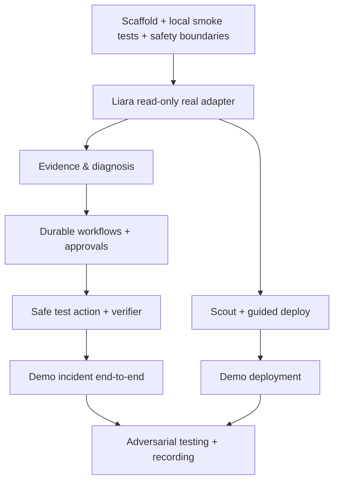

# 13 · نقشه راه اجرایی، وابستگی‌ها و مدیریت ریسک مسابقه
**نکته:** این سند milestone-based است؛ تا زمان اعلام deadline و ظرفیت تیم، تاریخ ساختگی یا وعده زمانی ارائه نمی‌شود.
## مسیر بحرانی

## Backlog مرتب‌شده بر اساس ارزش و ریسک
| Epic | خروجی قابل قبول | وابستگی | اولویت |
|---|---|---|---|
| E01: Foundation | Python backend, typed config, SQLite ledger, local smoke | هیچ | P0 |
| E02: Liara read | project/log/events/releases/metrics typed fixtures + live smoke | E01 | P0 |
| E03: Evidence store | timestamp UTC, completeness, redaction, citations | E02 | P0 |
| E04: Investigation | candidate hypotheses + contradiction + inconclusive | E03 | P0 |
| E05: UX | RTL incident + evidence + preview + status | E04 | P0 |
| E06: Policy approvals | action binding, replay prevention, audit | E01/E05 | P0 |
| E07: Executor+Verifier | test-only restart; accepted != recovered | E02/E06 | P0 |
| E08: Scout | static manifest scan; platform/env names/port | E01 | P1 |
| E09: Deploy | CLI integration + create/release and health | E08/E06 | P1 |
| E10: Domain | DNS ownership/check + manual handoff | E09 | P1 |
| E11: Optional LLM | structured hypothesis + strict citations | E04 | P2 |
| E12: Coding PR | patch in isolated repo + human review | E11 | P2 |
## Sprint خروجی‌محور
**Iteration A / trustable reads:** ایجاد skeleton، پروژه‌های واقعی، schema validation و خطاهای واقعی در UI. دمو: فهرست و گزارش read-only با «نامعلوم» واقعی.
**Iteration B / intelligent diagnosis:** corpus رخداد مصنوعی + incident timeline و report با شناسه شواهد. دمو: تمایز deploy-related و resource-related.
**Iteration C / controlled action:** approval یک‌بارمصرف، اجرای محدود روی test app و verifier. دمو: complete incident loop.
**Iteration D / guided deploy:** Scout، CLI sandbox، port/env guide و domain wizard؛ نسخه deploy-only دمو.
**Iteration E / submission:** adversarial and UX testing، مستندات با test artifacts، ویدیوی مناسب داور.
## ریسک‌های بالا و پاسخ
- **شکاف spec و runtime:** contract tests قبل از write؛ fallback explicit unavailable.
- **عدم دسترسی به سرویس آزمایشی:** parallel mock development و gate hard برای live claims.
- **نامعلوم‌بودن unit metrics:** raw labels + no thresholds until calibrated.
- **زمان کم:** اول P0 loop، سپس P1 deploy؛ حذف موقت analytics پیچیده و LLM agent swarm.
- **حوادث ری‌استارت/اسرار:** allowlist disposable، blast radius preview و server-only credentials.
- **LLM latency/cost:** rules baseline + model optional.
- **ارائه نامطمئن:** preflight recorded environment و fallback mock با برچسب آشکار.
## Definition of Done هر Epic
Code merged + unit tests + failure tests + audit demonstration + docs/ADR updated + evidence with SHA؛ فقط عبور از DoD اجازه تغییر maturity label می‌دهد.
## تصمیم‌های توقف
اگر API credential یا test project آماده نیست: live write را آغاز نکن. اگر approvals durable نیست: app write غیرفعال. اگر verifier مستقل نیست: موفقیت ادعا نکن. اگر اتصال deploy نامعلوم است: آن را برای دمو به‌عنوان mock نشان بده.